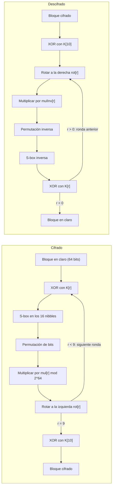

# KDSPN-64

Cifrado por bloques con tablas derivadas de la clave, implementado en C++17, con línea de comandos e interfaz gráfica.

KDSPN-64 es una red de sustitución-permutación (SPN) de 64 bits de bloque y 128 bits de clave. A diferencia de un SPN clásico, **la clave no solo se mezcla con XOR: también decide la S-box, la permutación de bits, las rotaciones y los multiplicadores** de cada ronda. Cada clave arma su propio cifrado.

> **Es un cifrado de juguete con fines didácticos.** No es seguro y no debe usarse para proteger información real. Ver [Limitaciones y ataques conocidos](#limitaciones-y-ataques-conocidos).

Desarrollado como proyecto de la materia _Integration of Computer Security in Networks and Software Systems_ (Tecnológico de Monterrey).

## Contenido

- [Características](#características)
- [Parámetros](#parámetros)
- [Estructura del repositorio](#estructura-del-repositorio)
- [Diseño del algoritmo](#diseño-del-algoritmo)
- [Derivación de las tablas](#derivación-de-las-tablas-desde-la-clave)
- [Modo CBC, relleno y formatos](#modo-cbc-relleno-y-formatos)
- [Resultados medidos](#resultados-medidos)
- [Compilación](#compilación)
- [Uso](#uso)
- [Pruebas](#pruebas)
- [Limitaciones y ataques conocidos](#limitaciones-y-ataques-conocidos)

## Características

- Cifra y descifra textos de hasta 100 bytes y archivos de cualquier tamaño.
- Tres operaciones de confusión y dos de difusión por ronda, todas invertibles.
- Tablas (S-box, permutación, rotaciones, multiplicadores y subclaves) derivadas de la clave con un generador determinista, por lo que el resultado es idéntico en cualquier compilador.
- Modo CBC con relleno PKCS#7 e IV aleatorio.
- Medición del efecto avalancha incluida (`ciber avalanche`).
- Línea de comandos (`ciber`) e interfaz gráfica en Tkinter.
- Suite de pruebas propia, sin dependencias externas.

La idea de que las S-boxes dependan de la clave tiene antecedentes reales: Blowfish y Twofish también la usan.

## Parámetros

| Parámetro                 | Valor                                                                |
| ------------------------- | -------------------------------------------------------------------- |
| Estructura                | SPN con tablas derivadas de la clave                                 |
| Bloque                    | 64 bits (8 bytes)                                                    |
| Clave                     | 128 bits (1 a 16 caracteres, o exactamente 32 dígitos hexadecimales) |
| Rondas                    | 10, más un XOR final con la subclave 11 (blanqueo)                   |
| Modo de operación         | CBC con relleno PKCS#7 e IV aleatorio                                |
| Salida de texto           | Hexadecimal en mayúsculas                                            |
| Generador para las tablas | splitmix64 (siembra) + xoshiro256\*\*                                |

## Estructura del repositorio

| Archivo               | Descripción                                                                                         |
| --------------------- | --------------------------------------------------------------------------------------------------- |
| `Config.h`            | Constantes: `BLOCK_BYTES`, `KEY_BYTES`, `ROUNDS`, `SUBKEYS`, `MAX_TEXT_BYTES`, `MAX_TABLE_ATTEMPTS` |
| `txtToBinary.h/.cpp`  | Lectura y escritura de archivos en modo binario                                                     |
| `Block.h/.cpp`        | Conversión entre 8 bytes y un `uint64_t` (el primer byte va a los bits altos)                       |
| `Prng.h/.cpp`         | splitmix64 y xoshiro256\*\*, deterministas en cualquier compilador                                  |
| `Tables.h/.cpp`       | `PRESENT_SBOX` (solo para pruebas), `invertTable`, `modInverse`                                     |
| `SPN.h/.cpp`          | Operaciones de la ronda: `subNibbles`, `permuteBits`, `rotl`, `rotr`                                |
| `KeySchedule.h/.cpp`  | Deriva todas las tablas de la clave (`Schedule`)                                                    |
| `BlockCipher.h/.cpp`  | Cifrado y descifrado de un bloque                                                                   |
| `Padding.h/.cpp`      | Relleno PKCS#7                                                                                      |
| `Cbc.h/.cpp`          | Modo CBC                                                                                            |
| `Encoding.h/.cpp`     | Hexadecimal y lectura de la clave del usuario                                                       |
| `TextCipher.h/.cpp`   | Cifrado y descifrado de texto (lo que usan la CLI y la GUI)                                         |
| `Avalanche.h/.cpp`    | Medición del efecto avalancha                                                                       |
| `main.cpp`            | Línea de comandos `ciber`                                                                           |
| `gui/ciber_gui.py`    | Interfaz gráfica (Tkinter) que invoca a `ciber`                                                     |
| `tests/test_main.cpp` | Pruebas (`ciber_tests`)                                                                             |
| `kdspn-animacion/`    | Animación interactiva del algoritmo (TypeScript + Vite), en desarrollo                              |

---

## Diseño del algoritmo

### La ronda

Cada una de las 10 rondas aplica cinco operaciones al bloque `s` de 64 bits :

| #   | Operación                                     | Código                      | Tipo                 |
| --- | --------------------------------------------- | --------------------------- | -------------------- |
| 1   | XOR con la subclave de la ronda               | `s ^= K[r]`                 | Confusión            |
| 2   | S-box de 4 bits en cada uno de los 16 nibbles | `SPN::subNibbles(s, sbox)`  | Confusión            |
| 3   | Permutación de los 64 bits                    | `SPN::permuteBits(s, perm)` | Difusión             |
| 4   | Multiplicación por un impar, módulo 2^64      | `s *= mul[r]`               | Confusión y difusión |
| 5   | Rotación circular a la izquierda              | `SPN::rotl(s, rot[r])`      | Difusión             |

Al final de las 10 rondas: `s ^= K[10]` (blanqueo).

### Función de cada operación

- **XOR con la subclave.** Introduce la clave en los datos. Sin él, el resto sería público una vez conocidas las tablas.
- **S-box.** Es la única parte no lineal respecto al XOR. Sin ella, todo el cifrado sería un sistema de ecuaciones lineales sobre bits, resoluble con álgebra.
- **Permutación de bits.** Reparte los 4 bits que salen de cada S-box hacia 4 S-boxes distintas de la ronda siguiente (ver [la condición de los nibbles](#la-condición-de-los-nibbles)). En pocas rondas cada bit de entrada influye en todo el bloque.
- **Multiplicación por un impar.** Mezcla muchos bits a la vez: por los acarreos, cada bit afecta a todos los bits de su misma posición hacia arriba.
- **Rotación.** Al multiplicar módulo 2^64, un bit solo influye hacia arriba, nunca hacia abajo. La rotación (distinta en cada ronda) baja los bits altos y la siguiente multiplicación los vuelve a esparcir. Por eso la multiplicación y la rotación van juntas.
- **Blanqueo final.** Sin el último XOR, un atacante podría deshacer la última rotación sin conocer la clave.

### Descifrado

Aplica las inversas en orden contrario y recorre las rondas de la última a la primera:

```text
s ^= K[10]
para r = 9 hasta 0:
    s = rotr(s, rot[r])            deshace la rotación
    s *= mulInv[r]                 deshace la multiplicación: mul * mulInv == 1 (mod 2^64)
    s = permuteBits(s, invPerm)    deshace la permutación
    s = subNibbles(s, invSbox)     deshace la S-box
    s ^= K[r]                      deshace el XOR: (x ^ k) ^ k == x
```

### Diagrama de flujo



---

## Derivación de las tablas desde la clave

La clave de 16 bytes se parte en dos mitades de 64 bits (`hi` y `lo`, con `Block::bytesToBlock`). Con ellas se siembra el generador y se derivan las piezas **en este orden exacto**; cambiar el orden produce otro cifrado.

| #   | Pieza                  | Cómo se obtiene                                               | Por qué es invertible                        |
| --- | ---------------------- | ------------------------------------------------------------- | -------------------------------------------- |
| 1   | S-box de 4 bits        | Barajar 0 a 15 (Fisher-Yates) hasta que no tenga puntos fijos | Es una permutación: su inversa es otra tabla |
| 2   | Permutación de 64 bits | Barajar 0 a 63 hasta que cumpla la condición de los nibbles   | Es una permutación: su inversa es otra tabla |
| 3   | 10 rotaciones          | `1 + next() % 63`: entre 1 y 63                               | Se rota hacia el otro lado                   |
| 4   | 10 multiplicadores     | `next() \| 1`: impar                                          | Todo impar tiene inverso módulo 2^64         |
| 5   | 11 subclaves           | `next()`                                                      | El XOR se deshace con el mismo XOR           |

### El generador

Se usan splitmix64 (para pasar de 128 bits de clave a 256 bits de estado) y xoshiro256\*\* (para generar). Son algoritmos públicos definidos bit por bit, así que dan exactamente el mismo resultado en cualquier compilador. **No se usa `rand`, `std::mt19937` ni `std::shuffle`**: su salida puede variar entre compiladores o bibliotecas, y un texto cifrado en una máquina podría no descifrarse en otra.

### S-box sin puntos fijos

Se descartan las S-boxes con algún `sbox[x] == x`, porque ese nibble pasaría sin cambio. Para la clave `0123456789ABCDEF` la S-box resultante es `4DE8BC23615F7A90`.

### La condición de los nibbles

La permutación se acepta solo si **los 4 bits de cada nibble van a 4 nibbles distintos** (`perm[4n+k] / 4` distintos para k = 0..3). Los 4 bits de salida de una S-box dependen fuertemente entre sí; si dos cayeran en la misma S-box de la ronda siguiente, esa S-box recibiría información redundante y la difusión sería más lenta. Con la condición, cada S-box alimenta a cuatro S-boxes distintas. La permutación de PRESENT cumple esta misma propiedad, y una prueba lo verifica (`KeySchedule::spreadsNibbles`).

Barajadas necesarias, medidas con las 5 claves de prueba:

| Clave                        | Intentos S-box | Intentos permutación |
| ---------------------------- | -------------- | -------------------- |
| 16 bytes `0x00`              | 8              | 103                  |
| 16 bytes `0xFF`              | 2              | 17                   |
| `0123456789ABCDEF`           | 3              | 243                  |
| `a` (rellena con ceros)      | 4              | 205                  |
| aleatoria (`mt19937_64(99)`) | 6              | 150                  |

El límite de seguridad es `MAX_TABLE_ATTEMPTS` = 1 000 000. Si se superara, `expand` lanza `std::runtime_error`; en la práctica bastan unos cientos de intentos.

### La multiplicación por un impar y su inverso

Un número par comparte el factor 2 con 2^64, por lo que no tiene inverso. Por eso el multiplicador siempre lleva `| 1`. El inverso se calcula **sin divisiones**, con la iteración de Newton (`Tables::modInverse`):

```text
inv = m                       // para todo impar, m * m == 1 (mod 8): ya es correcto en 3 bits
repetir 5 veces:
    inv = inv * (2 - m * inv) // cada vuelta duplica los bits correctos: 3, 6, 12, 24, 48, 96
```

Todo es `uint64_t`, así que el módulo 2^64 lo aplica el desbordamiento sin signo, que en C++ está bien definido.

---

## Modo CBC, relleno y formatos

- **Relleno PKCS#7 (bloque de 8):** se agregan `n = 8 - (largo % 8)` bytes con valor `n`, de 1 a 8. Un mensaje cuyo largo es múltiplo de 8 recibe un bloque completo de `0x08`, de modo que al quitarlo nunca hay ambigüedad.
- **CBC:** `C[0] = IV`, `C[i] = E(P[i] XOR C[i-1])`. Al descifrar, `P[i] = D(C[i]) XOR C[i-1]`. Por el encadenamiento, dos bloques iguales del mensaje producen bloques cifrados distintos.
- **IV:** 8 bytes aleatorios de `std::random_device`. No es secreto y va al inicio de la salida. Por eso cifrar dos veces el mismo texto da resultados distintos.
- **Formato cifrado:** `IV (8 bytes) || C[1] ... C[n]`, de `8 + largo con relleno` bytes. En texto se muestra en hexadecimal en mayúsculas. Al leer se ignoran espacios y saltos de línea y se aceptan minúsculas.
- **Clave de usuario:** de 1 a 16 bytes de texto (rellenos con `0x00`) o exactamente 32 dígitos hexadecimales. No hay ambigüedad: un texto mide como máximo 16 y una clave hexadecimal 32. Cualquier otra entrada da un error claro.
- **Límite de texto:** la capa de texto y la GUI rechazan más de 100 **bytes** (una letra con acento ocupa 2 bytes en UTF-8). El núcleo cifra archivos de cualquier tamaño.
- **Clave equivocada:** casi siempre el relleno sale inválido y el programa informa un error. En ocasiones el relleno sale válido por azar y se obtiene basura sin error, pero nunca se recupera el texto original.

---

## Resultados medidos

### Efecto avalancha

Salida de `ciber avalanche`, con la clave `0123456789ABCDEF` y `std::mt19937_64(12345)`:

```text
Avalancha de texto plano: 32.01 bits de 64 (1000 bloques x 64 bits volteados)
Avalancha de clave:       32.04 bits de 64 (50 bloques x 128 bits de clave volteados)
Ideal: 32 bits. Aceptable: de 28 a 36. Tiempo: 0.11 s
```

Voltear un solo bit del texto plano cambia en promedio 32.01 de los 64 bits del cifrado, y voltear un bit de la clave cambia 32.04: prácticamente el ideal de 32 (la mitad).

### Las tablas cambian con la clave

| Clave                              | S-box derivada     |
| ---------------------------------- | ------------------ |
| `0123456789ABCDEF`                 | `4DE8BC23615F7A90` |
| `otra clave`                       | `3C0D26A9EB158F47` |
| `00112233445566778899AABBCCDDEEFF` | `9BCE0F4A125378D6` |

---

## Compilación

Requisitos: un compilador de C++17 (probado con MinGW GCC 13.1 y GCC 14.2 de MSYS2) y Python 3 con Tkinter para la interfaz gráfica.

### Con g++ (desde la raíz de este repositorio)

```bash
# Programa de línea de comandos
g++ -std=c++17 -Wall -Wextra -I. *.cpp -o ciber -static -lshell32

# Pruebas: todos los .cpp menos main.cpp
g++ -std=c++17 -Wall -Wextra -I. tests/test_main.cpp Avalanche.cpp Block.cpp BlockCipher.cpp Cbc.cpp \
    Encoding.cpp KeySchedule.cpp Padding.cpp Prng.cpp SPN.cpp Tables.cpp TextCipher.cpp txtToBinary.cpp \
    -o ciber_tests -static
```

`-lshell32` solo hace falta en Windows (la CLI lee los argumentos en UTF-8 con `CommandLineToArgvW`). `-static` permite que `ciber.exe` corra sin las DLL de MinGW en el `PATH`, que es lo que necesita la GUI.

### Con CMake

El proyecto se desarrolló en CLion, donde este repositorio es la carpeta `CypherAlgorithm/` y el `CMakeLists.txt` está en la carpeta de arriba (no se versiona). Contenido:

```cmake
cmake_minimum_required(VERSION 3.16)
project(ciber CXX)
set(CMAKE_CXX_STANDARD 17)
set(CMAKE_CXX_STANDARD_REQUIRED ON)

add_library(cipher_core STATIC
        CypherAlgorithm/txtToBinary.cpp CypherAlgorithm/Block.cpp CypherAlgorithm/SPN.cpp
        CypherAlgorithm/Prng.cpp CypherAlgorithm/Tables.cpp CypherAlgorithm/KeySchedule.cpp
        CypherAlgorithm/BlockCipher.cpp CypherAlgorithm/Padding.cpp CypherAlgorithm/Cbc.cpp
        CypherAlgorithm/Encoding.cpp CypherAlgorithm/TextCipher.cpp CypherAlgorithm/Avalanche.cpp)
target_include_directories(cipher_core PUBLIC CypherAlgorithm)
if(NOT MSVC)
    target_compile_options(cipher_core PUBLIC -Wall -Wextra)
endif()

add_executable(ciber CypherAlgorithm/main.cpp)
target_link_libraries(ciber PRIVATE cipher_core)
if(WIN32)
    target_link_libraries(ciber PRIVATE shell32)
endif()

enable_testing()
add_executable(ciber_tests CypherAlgorithm/tests/test_main.cpp)
target_link_libraries(ciber_tests PRIVATE cipher_core)
add_test(NAME ciber_tests COMMAND ciber_tests)

if(MINGW)
    target_link_options(ciber PRIVATE -static)
    target_link_options(ciber_tests PRIVATE -static)
endif()
```

Después de agregar un `.cpp` nuevo hay que incluirlo en `cipher_core` y recargar el proyecto CMake.

---

## Uso

### Línea de comandos

| Comando                                | Descripción                                                                           |
| -------------------------------------- | ------------------------------------------------------------------------------------- |
| `ciber enc-text "<texto>" <clave>`     | Cifra un texto (máx. 100 bytes) e imprime el hexadecimal                              |
| `ciber dec-text <hex> <clave>`         | Descifra el hexadecimal e imprime el texto                                            |
| `ciber enc <entrada> <salida> <clave>` | Cifra un archivo; la salida es binaria (`IV \|\| cifrado`)                            |
| `ciber dec <entrada> <salida> <clave>` | Descifra un archivo                                                                   |
| `ciber tables <clave>`                 | Muestra la S-box, la permutación, las rotaciones, los multiplicadores y las subclaves |
| `ciber avalanche`                      | Mide la avalancha de texto plano y de clave                                           |

Devuelve 0 si todo va bien y 1 si hay cualquier error. Los errores van a `stderr` y en ese caso no se escribe nada en `stdout`. Se rechazan una salida igual a la entrada, un texto de más de 100 bytes, una clave o un hexadecimal inválidos y un archivo inexistente. Si el descifrado de un archivo falla, no se escribe ningún archivo de salida.

Ejemplo (el hexadecimal cambia en cada ejecución por el IV aleatorio):

```text
> ciber enc-text "Hola mundo" 0123456789ABCDEF
13314975EFC8F2DBCCC5624252DC15A12B24B20CBB39CF9A
> ciber dec-text 13314975EFC8F2DBCCC5624252DC15A12B24B20CBB39CF9A 0123456789ABCDEF
Hola mundo
> ciber dec-text 13314975EFC8F2DBCCC5624252DC15A12B24B20CBB39CF9A 0123456789ABCDEG
Error: no se pudo descifrar: la clave es incorrecta o el cifrado esta danado
```

Los 48 dígitos hexadecimales son 24 bytes: 8 del IV más 16 del mensaje (10 bytes de "Hola mundo" más 6 de relleno).

La consola de Windows muestra la `ó` como `├│`. No es un error de datos; para comparar archivos conviene usar `fc /b`.

### Interfaz gráfica

```bash
python gui/ciber_gui.py
```

La interfaz no contiene nada del algoritmo: cada botón ejecuta `ciber`. La ruta de `ciber.exe` está en el campo superior; por defecto toma el compilado más reciente de `cmake-build-debug`, `cmake-build-release` o `cmake-build-claude`.

| Elemento                              | Descripción                                                                                                             |
| ------------------------------------- | ----------------------------------------------------------------------------------------------------------------------- |
| Clave                                 | 1 a 16 caracteres o 32 dígitos hexadecimales                                                                            |
| Texto original                        | Con contador de bytes; se pone en rojo después de 100                                                                   |
| `Cifrar ↓`                            | Cifra el texto y muestra el hexadecimal abajo                                                                           |
| Texto cifrado                         | Editable: admite pegar un cifrado, incluso partido en líneas                                                            |
| `Descifrar ↑`                         | Descifra el cuadro inferior y muestra el texto arriba                                                                   |
| `Abrir archivo` / `Guardar resultado` | Cada cuadro tiene los suyos: arriba cargan o guardan el texto original y abajo el texto cifrado (hexadecimal), en UTF-8 |
| `Ver tablas`                          | Muestra las tablas derivadas de la clave escrita                                                                        |

Los errores (clave inválida, hexadecimal inválido, clave equivocada, texto de más de 100 bytes) se muestran en un mensaje sin cerrar el programa.

### Animación

`kdspn-animacion/` contiene una animación paso a paso del algoritmo (de la clave a las tablas, del texto a los bloques CBC y las 10 rondas), hecha con TypeScript y Vite. Está en desarrollo; requiere Node 20 o superior:

```bash
cd kdspn-animacion
npm install
npm run dev     # servidor de desarrollo
npm test        # pruebas (vitest)
npm run build   # revisa tipos y genera dist/
```

---

## Pruebas

`ciber_tests` ejecuta **229 comprobaciones** sin dependencias externas (un marco `CHECK` propio), con 0 advertencias de compilación con `-Wall -Wextra`:

| Grupo                | Qué comprueba                                                                                                                                                                 |
| -------------------- | ----------------------------------------------------------------------------------------------------------------------------------------------------------------------------- |
| Block, txtToBinary   | Vectores fijos, ida y vuelta, `ó` como 195 179, `\r\n`, archivo vacío, excepciones                                                                                            |
| Prng                 | Vector publicado de splitmix64 (`0xE220A8397B1DCDAF`), determinismo, semillas distintas dan secuencias distintas                                                              |
| Tables               | Vectores de `modInverse`; `m * modInverse(m) == 1` para 1000 impares; inversión de tablas; tablas inválidas                                                                   |
| SPN                  | Vectores con la S-box y la permutación de PRESENT; ida y vuelta de 10 000 valores; la permutación conserva el número de unos; rotaciones                                      |
| KeySchedule          | Para 5 claves: S-box sin puntos fijos, condición de los nibbles, rotaciones de 1 a 63, impares con inverso, 11 subclaves, determinismo, claves distintas dan tablas distintas |
| BlockCipher          | Ida y vuelta de 10 000 bloques por clave; una clave que difiere en 1 bit no descifra; vectores de regresión                                                                   |
| Padding, Cbc         | Largos de relleno; rellenos inválidos; ida y vuelta de 0 a 64, 100 y 1000 bytes; IV distintos dan cifrados distintos; 3 bloques iguales cifran distinto                       |
| Encoding, TextCipher | Hexadecimal con espacios y minúsculas; claves válidas e inválidas; 100 bytes sí y 101 no; clave equivocada nunca da el original                                               |
| Avalancha            | Los dos promedios entre 28 y 36, en menos de 10 s                                                                                                                             |

**Vectores cruzados.** Como el cifrado es propio, no existen vectores publicados. Para no depender solo de este código, se contrastó con una implementación independiente de la especificación escrita en Python (no incluida en el repositorio). Las tablas derivadas (S-box, permutación, rotaciones, multiplicadores, subclaves y número de intentos) y los cifrados de 3 bloques con 3 claves coinciden exactamente con los del C++, y quedaron guardados como pruebas de regresión.

**Línea de comandos.** Se verificó el ciclo cifrar y descifrar de un archivo (`m de megalodón`, 15 bytes) con clave de texto y con clave hexadecimal; un archivo vacío (16 bytes de cifrado: IV más un bloque de relleno); un archivo con `\r\n`; y un texto de 100 bytes. `fc /b` no encontró diferencias. Cada error devuelve 1 y deja `stdout` vacío.

**Interfaz gráfica.** Las funciones que llaman a `ciber` se probaron sin abrir la ventana: cifrar, descifrar, hexadecimal pegado con espacios, acentos en el texto y en la clave, clave equivocada, límite de 100 bytes, tablas distintas y ejecutable inexistente.

---

## Limitaciones y ataques conocidos

KDSPN-64 sirve para aprender cómo se construye un cifrado, no para proteger nada. Sus debilidades conocidas:

1. **El generador no es criptográfico y es invertible.** Las subclaves son salidas directas de xoshiro256\*\*, cuya función de salida se puede invertir. Con unas cuantas subclaves consecutivas se reconstruye el estado del generador y, de ahí, todas las tablas. Como splitmix64 también es invertible, **se llega hasta la clave**. Un cifrado real derivaría las tablas con una función criptográfica (por ejemplo, un hash o un cifrado ya probado).
2. **S-boxes al azar.** Solo se descartan las que tienen puntos fijos. Una S-box barajada al azar puede tener malas propiedades diferenciales o lineales, mientras que la de PRESENT se eligió a propósito contra esos ataques. Algunas claves pueden dar cifrados más débiles que otras.
3. **Criptoanálisis diferencial y lineal.** Con 10 rondas de un diseño sin análisis formal, no hay garantía de resistencia. No se han calculado las mejores características diferenciales de este cifrado.
4. **Bloque de 64 bits.** Por la paradoja del cumpleaños, tras unos 2^32 bloques (32 GB) cifrados con la misma clave empiezan a repetirse bloques en CBC, lo que filtra información (ataques tipo Sweet32).
5. **CBC no autentica.** No detecta modificaciones del cifrado: cambiar un bit del IV cambia el mismo bit del primer bloque descifrado.
6. **Oráculo de relleno.** El programa responde distinto a un relleno inválido que a uno válido. Un atacante que pueda pedir descifrados y observar la respuesta puede recuperar el texto byte por byte (ataque de Vaudenay, 2002).
7. **Claves de texto.** Una clave de texto corta tiene mucha menos entropía que 128 bits y se rompe por fuerza bruta. No hay función de derivación de claves (KDF) ni sal.
8. **El efecto avalancha no demuestra seguridad.** Una avalancha de 32 bits es necesaria pero no suficiente: un cifrado puede tener buena avalancha y aun así romperse.
